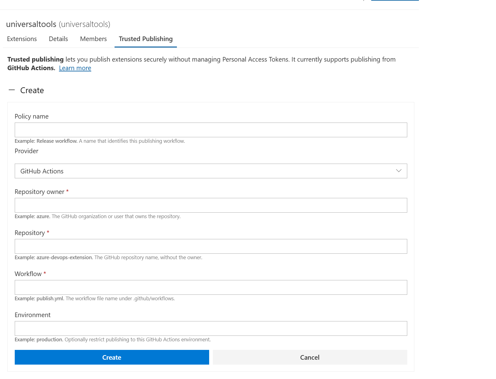

# Releasing UniversalTools

Releases are automatic. When a pull request that changes `"version"` in `package.json` is merged into `master`, the [Release workflow](.github/workflows/release.yml):

1. checks that `packs/` matches `packs/packs.json` and every extension against the Marketplace,
2. builds a `.vsix` for every pack in `packs/packs.json` plus the main pack into `dist/` (15 as of 4.4.0), installs them into a clean VS Code and runs the integration tests,
3. creates the GitHub release `vX.Y.Z` with every `.vsix` file attached and the matching `CHANGELOG.md` section as notes,
4. publishes to the VS Code Marketplace, and to Open VSX if enabled, in this order: the sub-packs the main pack installs (all of them as of 4.6.0), then the main pack, then any standalone packs (`"includeInMain": false` in `packs/packs.json`). One failure does not stop the others; the job fails at the end and lists every extension that failed.

All extensions share the version in the root `package.json`; `npm run sync` copies it into `packs/`.

Merges that do not change the version do nothing. Pushing a tag `vX.Y.Z` that matches `package.json` also releases.

## Making a release

1. In your branch, bump the version: `npm version minor --no-git-tag-version` (or `patch` / `major`), then `npm run sync`.
2. Add a `## [X.Y.Z]` section at the top of `CHANGELOG.md`.
3. Open a PR. CI runs the same checks without publishing.
4. Merge it. The release follows within a few minutes; watch it under **Actions → Release**.

The Marketplace accepts only `major.minor.patch` versions, and each version can be published once.

## If publishing fails partway

The Marketplace allows only about **7 new extensions per 12 hours**; updating existing ones is not limited. A release that adds more new packs than that will fail on the rest with *"You have exceeded the maximum number of extensions that can be created in 12 hour(s)"*. Wait until the earliest creations are 12 hours old, then use **Re-run failed jobs** on the run (or `gh run rerun <run-id> --failed`). Extensions already at the new version are skipped (`--skip-duplicate`), so only the missing ones are published.

## Pre-releases

The version number decides the channel, following the Marketplace's recommended convention:

| Version | Published as |
|---|---|
| Even minor: `4.0.x`, `4.2.x`, … | Normal release |
| Odd minor: `4.1.x`, `4.3.x`, … | Pre-release (GitHub *Pre-release*, Marketplace and Open VSX `--pre-release`) |

So to ship a pre-release, bump to an odd minor (`npm version 4.1.0 --no-git-tag-version`) and merge as usual. Users get it only if they choose **Switch to Pre-Release Version** on the extension page in VS Code. A version number can be used only once across both channels.

## One-time setup

### 1. VS Code Marketplace: Trusted Publishing (no token needed)

Azure DevOps retires global Personal Access Tokens on **December 1, 2026**. The workflow therefore publishes with Trusted Publishing (OpenID Connect) and stores no Marketplace token in GitHub. You do **not** need to create a PAT.

1. Open <https://marketplace.visualstudio.com/manage/publishers/universaltools> and sign in with the account that owns the **universaltools** publisher.
2. Click the **Trusted Publishing** tab (next to *Extensions*, *Details*, *Members*).
3. Expand **Create** and fill in the form exactly like this (fields are case-sensitive):

   | Field | Enter |
   |---|---|
   | Policy name | `Release workflow` |
   | Provider | `GitHub Actions` (already selected) |
   | Repository owner | `otabekoff` |
   | Repository | `universaltools` |
   | Workflow | `release.yml` |
   | Environment | `marketplace` |

   

4. Click **Create**. The policy appears in the list on the same tab.

The repository is public, so the policy has no 48-hour activation deadline; it activates the first time the Release workflow publishes.

The policy belongs to the publisher, so the one policy covers every extension it publishes, including brand-new ones: the five web sub-packs were created this way in 4.0.0.

### 2. GitHub environment

The publishing jobs run in the `marketplace` environment, which only `master` and `v*` tags may deploy to. It is created with:

```sh
gh api -X PUT repos/otabekoff/universaltools/environments/marketplace \
  --input - <<'EOF'
{ "deployment_branch_policy": { "protected_branches": false, "custom_branch_policies": true } }
EOF
gh api -X POST repos/otabekoff/universaltools/environments/marketplace/deployment-branch-policies -f name=master -f type=branch
gh api -X POST repos/otabekoff/universaltools/environments/marketplace/deployment-branch-policies -f name='v*' -f type=tag
```

To approve every publish by hand, add yourself as a required reviewer under **Settings → Environments → marketplace**.

### 3. Open VSX (optional)

Open VSX serves VSCodium, Cursor, Windsurf and other VS Code–based editors. It also supports Trusted Publishing, but only for an extension that **already exists** there, so the very first version of each extension is published once with a token. Each extension then needs its own Trusted Publisher registration. Source: [Open VSX Trusted Publishing](https://github.com/eclipse/openvsx/wiki/Trusted-Publishing).

Note: 12 of the 69 extensions in the packs are not on Open VSX (for example Simple React Snippets, Google Translate, Random Everything), so editors that use Open VSX cannot install those.

1. **Publisher Agreement:** on open-vsx.org, open **Profile**, choose **Log in with Eclipse** (create an eclipse.org account with the same GitHub username if needed), then **Show Publisher Agreement** → **Agree**.
2. **Namespace:** in user settings, click **+** next to *Namespaces* and create `universaltools`, all lower-case. It must match `"publisher"` in `package.json` exactly, or Trusted Publishing is rejected.
3. **Ownership:** creating a namespace does not make you its verified owner, and Trusted Publishing requires an owner. Open an issue at [EclipseFdn/open-vsx.org](https://github.com/EclipseFdn/open-vsx.org/issues/new/choose) with the namespace template. Because `universaltools` is also your VS Code Marketplace publisher, include a link showing you control it (the [Marketplace page](https://marketplace.visualstudio.com/items?itemName=universaltools.universaltools) and this repository).
4. **First publish, once, with a token:** under **Access Tokens**, generate a token, then in PowerShell from this folder:
   ```powershell
   npm run package
   $env:OVSX_PAT = "<token>"; npm run publish:openvsx-first; Remove-Item Env:OVSX_PAT
   ```
   This uploads the web sub-packs, the main pack, then the language packs. Delete the token on open-vsx.org afterwards; it is not needed again.
5. **Trusted Publishers:** under **Trusted Publishers**, create **one registration per extension**: `universaltools` plus one `universaltools-<dir>` for every pack in `packs/packs.json`. For each, choose the `universaltools` namespace and the extension, provider **GitHub Actions**, and enter:

   | Field | Enter |
   |---|---|
   | Organization or User name | `otabekoff` |
   | Repository name | `universaltools` |
   | Workflow filename | `release.yml` |
   | Environment name | `marketplace` |

6. **Switch it on:**
   ```sh
   gh variable set PUBLISH_OPENVSX --body true --repo otabekoff/universaltools
   ```

From the next release on, the workflow publishes to Open VSX with `ovsx publish --trusted-publishing`; no token is stored in GitHub.

## Publishing by hand (fallback)

```sh
npm ci
npm test                   # sync check + verify + package + install test + integration tests
npx vsce login universaltools
# sub-packs first, then the main pack
npx vsce publish --skip-duplicate --packagePath dist/universaltools-web-core-X.Y.Z.vsix   # ...and the other sub-packs
npx vsce publish --skip-duplicate --packagePath dist/universaltools-X.Y.Z.vsix
```
